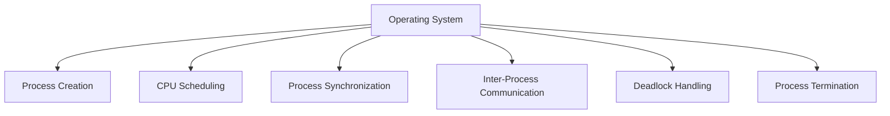
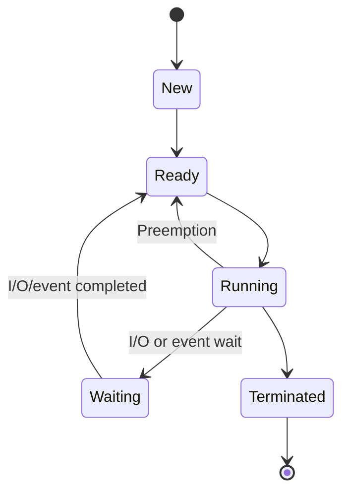
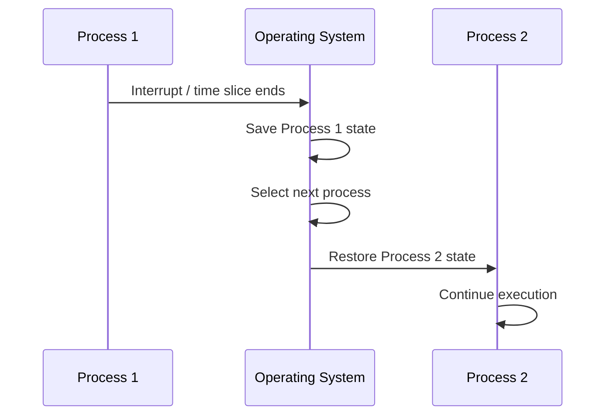
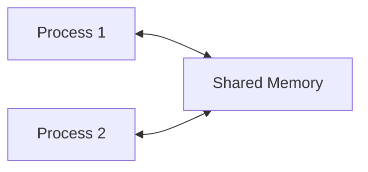

# Process Management in Operating Systems

## Overview

**Process management** is one of the core responsibilities of an Operating System.

A **process** is a program that is currently executing. The operating system must create processes, schedule them on the CPU, coordinate their access to resources, support communication between them, and eventually terminate them.

In a multitasking or multiprogramming system, many processes may exist at the same time, so the OS must decide **which process runs, when it runs, and how shared resources are protected**.



---

## Program vs Process

A **program** is a passive set of instructions stored on disk.

A **process** is an active execution of those instructions.

```text
Program:   web_browser.exe stored on disk
Process:   a running instance of the web browser
```

The same program can have multiple processes running at the same time.

---

## CPU-Bound and I/O-Bound Processes

### CPU-Bound Process
A CPU-bound process performs a large amount of computation and spends much of its time using the processor.

Examples:
- Mathematical calculations
- Data compression
- Scientific computation

### I/O-Bound Process
An I/O-bound process spends more time waiting for input/output operations than performing CPU computation.

Examples:
- Reading files
- Waiting for keyboard input
- Network communication
- Database access

Because CPUs are much faster than many I/O devices, an operating system can improve utilization by scheduling another ready process while one process is waiting for I/O.

---

## Major Process Management Tasks

### 1. Process Creation

When a process is created, the operating system prepares the information and resources required for it to execute.

This includes:
- Assigning a Process ID (PID)
- Creating process-management data structures
- Allocating required resources
- Preparing execution state
- Making the process available to the scheduler

---

## 2. Process Control Block (PCB)

The OS maintains information about each process in a data structure commonly called a **Process Control Block (PCB)**.

Conceptually, a PCB may contain:

```text
+--------------------------------+
| Process ID                     |
+--------------------------------+
| Process State                  |
+--------------------------------+
| Program Counter                |
+--------------------------------+
| CPU Register Information       |
+--------------------------------+
| Scheduling Information         |
+--------------------------------+
| Memory Management Information  |
+--------------------------------+
| I/O / Resource Information     |
+--------------------------------+
```

The PCB allows the operating system to stop a process and later continue it from the correct point.

---

## 3. Process States

A process moves through different states during its lifetime.

A common model includes:
- **New** — the process is being created.
- **Ready** — the process is prepared to run and is waiting for CPU time.
- **Running** — the process is currently executing on the CPU.
- **Waiting / Blocked** — the process is waiting for an event or I/O operation.
- **Terminated** — the process has completed execution.



---

## 4. CPU Scheduling

In a multiprogramming system, several processes may be ready to execute at the same time.

The **CPU scheduler** selects which ready process should receive the CPU.

Common scheduling concepts include:
- Ready queue
- Scheduling policy
- Priority
- Time quantum
- Preemption

Common CPU scheduling algorithms include:
- First-Come, First-Served (FCFS)
- Shortest Job First (SJF)
- Priority Scheduling
- Round Robin

---

## 5. Context Switching

A **context switch** occurs when the CPU stops executing one process and begins executing another.

The operating system saves the state of the current process and restores the saved state of the next process.



Context switching enables multitasking, but it also introduces overhead because the CPU spends some time switching instead of executing application work.

---

## 6. Process Synchronization

Multiple processes may access shared resources such as memory, files, or data structures.

If accesses are not coordinated, the result can depend on the order in which processes execute. This is known as a **race condition**.

Common synchronization mechanisms include:
- Locks
- Mutexes
- Semaphores
- Monitors
- Atomic operations

---

## 7. Inter-Process Communication (IPC)

Processes often need to exchange information. The operating system provides mechanisms for **Inter-Process Communication (IPC)**.

### Shared Memory
Multiple processes access a common region of memory.



Shared memory can be fast, but synchronization is necessary to prevent conflicting accesses.

### Message Passing
Processes communicate by sending and receiving messages.


---

## 8. Deadlock Handling

A **deadlock** can occur when processes wait indefinitely for resources held by one another.

Example:

```text
Process A holds Resource 1 and waits for Resource 2.
Process B holds Resource 2 and waits for Resource 1.
```

Neither process can continue.

Operating systems may use techniques for:
- Deadlock prevention
- Deadlock avoidance
- Deadlock detection
- Deadlock recovery

---

## 9. Process Termination

When a process terminates, the operating system performs cleanup such as:
- Releasing memory
- Closing files
- Releasing other resources
- Removing process-management information such as its PCB

Termination may happen because:
- The process finishes normally.
- The process encounters an error.
- The operating system terminates it.
- A parent or authorized process requests its termination.

---

## Why Process Management Matters

Process management allows an operating system to provide:
- Multitasking
- Better CPU utilization
- Fair resource sharing
- Process isolation
- Communication between processes
- Synchronization
- Efficient scheduling
- Controlled process creation and termination

---

## Summary

```text
Process Management
│
├── Process Creation
├── Process Control Block
├── Process States
├── CPU Scheduling
├── Context Switching
├── Process Synchronization
├── Inter-Process Communication
├── Deadlock Handling
└── Process Termination
```

Process management is the mechanism that allows the operating system to coordinate many active programs while keeping the CPU and other resources efficiently utilized.

## References

- GeeksforGeeks — Introduction of Process Management  
  https://www.geeksforgeeks.org/operating-systems/introduction-of-process-management/
- GeeksforGeeks — Operating System Tutorial  
  https://www.geeksforgeeks.org/operating-systems/operating-systems/
