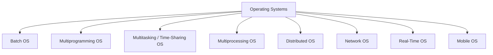
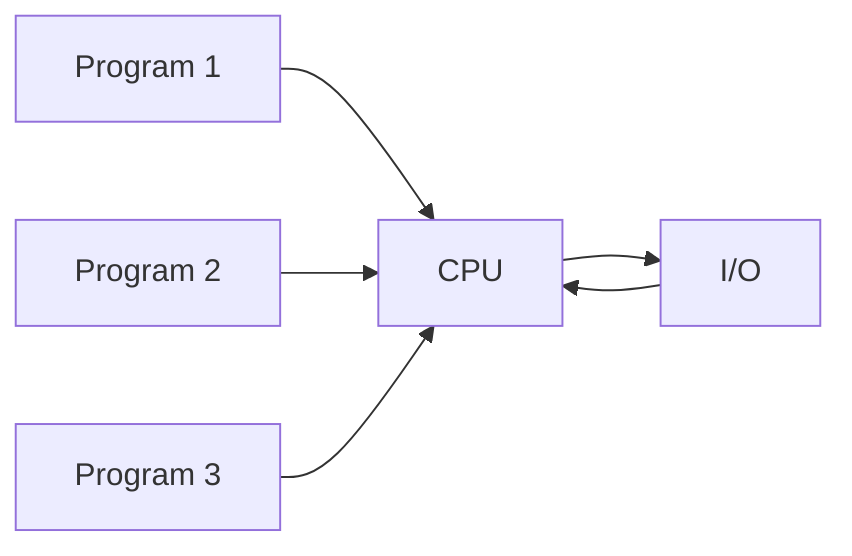
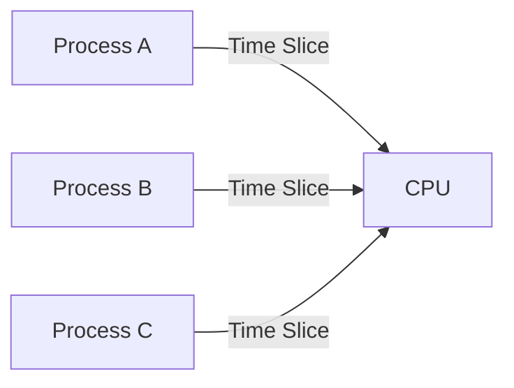

# Types of Operating Systems

## Overview

An **Operating System (OS)** is system software that manages hardware and software resources and provides an interface between users, applications, and the computer hardware.

Different operating systems are designed for different workloads. Some focus on processing large groups of jobs, some support many programs or users at once, and others are designed for distributed, networked, mobile, or real-time environments.

---

## 1. Batch Operating System

A **Batch Operating System** collects similar jobs and processes them as batches. Jobs are normally queued and executed one after another with little or no direct interaction from the user while they are running.

### Advantages
- Useful for large and repetitive workloads.
- Reduces the need for continuous human interaction.
- Can provide good throughput when many similar jobs must be processed.

### Disadvantages
- Response time can be high.
- Users do not receive immediate feedback.
- CPU utilization may be poor when a job spends significant time waiting for I/O.

### Typical Uses
- Payroll processing
- Billing systems
- Large report-generation jobs

---

## 2. Multiprogramming Operating System

A **Multiprogramming Operating System** keeps multiple programs in memory at the same time. When one program waits for I/O, the CPU can execute another program instead of remaining idle.

### Advantages
- Improves CPU utilization.
- Increases overall throughput.
- Makes better use of CPU, memory, and I/O resources.

### Disadvantages
- Requires more complex scheduling and memory management.
- Needs more memory.
- Multiple programs sharing a system introduces additional protection and security concerns.

### Typical Uses
- Banking systems
- Billing systems
- Multi-user computing environments

---

## 3. Multitasking / Time-Sharing Operating System

A **Multitasking or Time-Sharing OS** rapidly switches the CPU among processes. Each process receives a small amount of CPU time called a **time slice** or **quantum**.

This creates the effect that many programs are running at the same time.

### Advantages
- Provides interactive use.
- Shares CPU time among multiple tasks or users.
- Keeps CPU idle time low when scheduling is efficient.

### Disadvantages
- Scheduling is more complex.
- A system-wide failure can affect many users or processes.
- Shared resources require careful protection and synchronization.

---

## 4. Multiprocessing Operating System

A **Multiprocessing OS** uses more than one processor or CPU to execute processes.

### Advantages
- Higher processing speed.
- Better throughput.
- Can improve reliability if work can continue when one processor fails.

### Disadvantages
- More expensive hardware.
- More complex operating-system design.
- Performance depends on how effectively work is distributed among processors.

### Examples
- Linux
- UNIX
- macOS

---

## 5. Distributed Operating System

A **Distributed Operating System** coordinates multiple independent computers connected through a network so that they can cooperate and share resources.

Each machine has its own CPU and memory, but the system attempts to coordinate them as a larger computing environment.

### Advantages
- Resources and work can be distributed across machines.
- Systems can be expanded by adding more nodes.
- Failure of one node does not necessarily stop every other node.

### Challenges
- Network delays affect communication.
- Scheduling and resource management are more complicated.
- Security is harder because communication may travel across multiple systems and networks.
- Maintaining a consistent view of distributed data can be difficult.

### Examples
- Amoeba
- LOCUS

---

## 6. Network Operating System

A **Network Operating System (NOS)** runs on networked machines, especially servers, and provides services such as user management, security, file sharing, printer sharing, and remote access.

Unlike a distributed OS, users are generally aware that they are working with different machines connected through a network.

### Advantages
- Centralized administration.
- Easy resource sharing.
- Supports remote access.

### Disadvantages
- Server failure can affect dependent users.
- Servers and administration can be expensive.
- Requires regular maintenance and security updates.

### Examples
- Windows Server
- UNIX/Linux server systems

---

## 7. Real-Time Operating System

A **Real-Time Operating System (RTOS)** is designed for systems where responses must occur within defined timing requirements.

### Hard Real-Time OS
A hard real-time system has strict deadlines. Missing a deadline can cause the system to fail.

Examples:
- Airbag systems
- Safety-control systems
- Industrial control

### Soft Real-Time OS
A soft real-time system also values fast, predictable response, but a small delay is usually acceptable.

Examples:
- Multimedia applications
- Gaming
- Video streaming

### Advantages
- Predictable response times.
- Appropriate for time-sensitive systems.
- Efficient control of dedicated devices.

### Disadvantages
- Complex design and scheduling.
- Often designed for a limited set of tasks.
- Strict timing requirements can limit flexibility.

---

## 8. Mobile Operating System

A **Mobile Operating System** is designed specifically for smartphones, tablets, and other mobile devices.

It manages mobile hardware, applications, touch-based interaction, connectivity, storage, security, and power consumption.

### Advantages
- User-friendly interfaces.
- Large application ecosystems.
- Support for wireless and mobile connectivity.

### Disadvantages
- Battery limitations.
- Mobile security threats.
- Device fragmentation can complicate software compatibility.

### Examples
- Android
- iOS

---

## Comparison

| Type | Main Idea | Key Benefit | Main Challenge |
|---|---|---|---|
| Batch OS | Executes groups of jobs | High-volume repetitive processing | Poor interactivity |
| Multiprogramming OS | Keeps multiple programs in memory | Better CPU utilization | Complex scheduling and memory management |
| Multitasking / Time-Sharing OS | Shares CPU using time slices | Interactive multi-task execution | Scheduling overhead |
| Multiprocessing OS | Uses multiple CPUs | Higher throughput | Coordination complexity |
| Distributed OS | Coordinates multiple computers | Scalability and resource sharing | Network and consistency issues |
| Network OS | Manages network services and users | Centralized resource sharing | Server dependency |
| Real-Time OS | Responds within timing constraints | Predictable timing | Complex real-time scheduling |
| Mobile OS | Designed for mobile devices | Portability and app ecosystem | Battery, security, fragmentation |

---

## Key Takeaway

The type of operating system used depends on the problem being solved. Batch systems focus on large job workloads, multiprogramming and multitasking systems improve CPU sharing, multiprocessing systems use several CPUs, distributed and network systems coordinate connected computers, real-time systems prioritize deadlines, and mobile operating systems are optimized for portable devices.

## References

- GeeksforGeeks — Operating System Tutorial  
  https://www.geeksforgeeks.org/operating-systems/operating-systems/
- GeeksforGeeks — Types of Operating Systems  
  https://www.geeksforgeeks.org/operating-systems/types-of-operating-systems/
